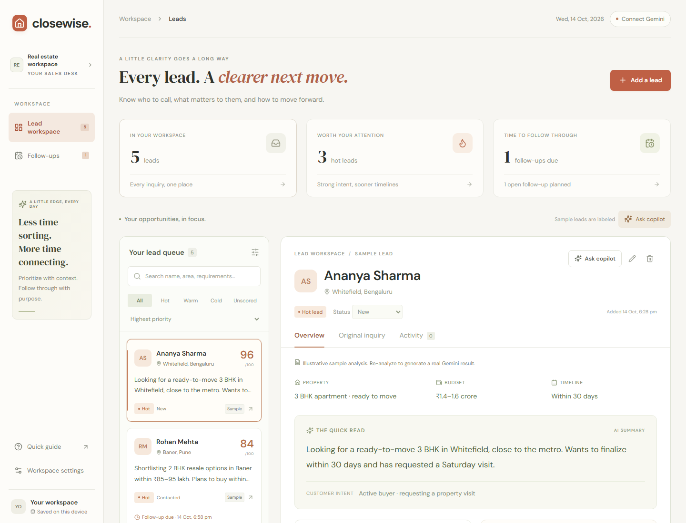
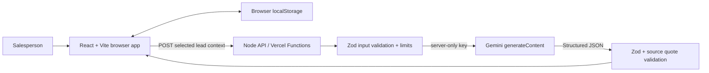

# Closewise

**An AI lead workspace for real-estate salespeople: understand the customer, prioritize the conversation, and follow through.**

Independent assignment project. Built with React, Vite, Node.js and Google Gemini. Ivory, terracotta and olive UI; no connection to any other project.

## What you can do

- Capture name, location, property requirement, budget, buying timeline and a customer message.
- Save multiple leads, search them, filter by Hot/Warm/Cold/Unscored and sort by score, creation time or follow-up time.
- Generate a summary, intent, requirements, concerns, missing information, next action and reply draft through **a real server-side Gemini API call**.
- Inspect an explained priority score rather than trusting an unexplained tag.
- Ask follow-up questions scoped to the selected lead. Rewrite replies, prepare for objections, and use recent call notes as context.
- **Added feature: the follow-up planner.** Convert the suggested action into a dated task, see due tasks, record the call outcome, update the lead status and complete the follow-up.
- Edit intake, copy a response, delete leads and export/import a JSON backup.
- Use the app on desktop or mobile. Lead data persists in the current browser.

Five fictional sample leads show the interface immediately. Their analysis is **hand-authored and labeled Sample**, not passed off as AI output. New analyses and every chat response always use Gemini. Missing keys or API failures never trigger canned answers.

This is a **single-salesperson prototype**, with no login, admin/manager accounts or RBAC. Multiple saved leads are supported; role-based team access is outside the assignment scope.



## Current delivery status

The complete source, runnable app, production build, automated tests, deployment instructions, code walkthrough, interview preparation and demo script are included. **Real Gemini analysis and chat have been verified locally**, including a full browser workflow with persistence, a call-note-grounded reply and follow-up completion. A live URL, public GitHub repository and recorded demo remain pending your publishing. Do not submit before completing [the submission checklist](docs/SUBMISSION.md).

Start with [SETUP_AND_DEPLOY.md](docs/SETUP_AND_DEPLOY.md). For your video and interview, read [CODE_WALKTHROUGH.md](docs/CODE_WALKTHROUGH.md), [DEMO_SCRIPT.md](docs/DEMO_SCRIPT.md) and [INTERVIEW_PREP.md](docs/INTERVIEW_PREP.md).

## Run locally

Requires Node.js **22.12 or newer** and npm.

```powershell
npm install
Copy-Item .env.example .env
```

Set `GEMINI_API_KEY` in `.env` using a key from [Google AI Studio](https://aistudio.google.com/apikey). Never commit `.env` and never use a `VITE_` prefix for this secret.

```powershell
npm run dev
```

Open **http://127.0.0.1:5173**. One command runs the React app on 5173 and the API on 3001. Vite proxies `/api` to the local server. No key is needed to inspect samples, save drafts, plan follow-ups or manage records. Real analysis and chat require the key.

```powershell
npm run check        # Unit/API tests + production build
npm run verify:ai    # Two real Gemini calls after you configure the key
npx playwright install chromium
npm run test:e2e     # Browser workflow tests; API responses are test fixtures
npm run build
npm start           # Serve built app + API at http://127.0.0.1:3001
```

The browser tests do not validate model quality or make real paid/provider calls. See [VALIDATION.md](docs/VALIDATION.md) for test evidence and the remaining real-model test.

## Architecture



The frontend and API run on the same origin. Vercel serves the Vite build and discovers the three files in `api/` as serverless functions. Local Express exposes those same shared handlers, so the prompt and business logic do not diverge between local development and deployment. This follows [Vercel's Vite deployment pattern](https://vercel.com/docs/frameworks/frontend/vite).

| Area         | Files                      | Responsibility                                                            |
| ------------ | -------------------------- | ------------------------------------------------------------------------- |
| App state    | `src/App.jsx`              | Saved leads, selection, search, filters, dialogs, actions and API status  |
| UI           | `src/components/`          | Queue, analysis workspace, scoped copilot and forms                       |
| Storage      | `src/lib/storage.js`       | Versioned browser persistence, backup and recovery                        |
| Shared rules | `shared/contracts.mjs`     | Zod schemas, score calculation, priorities, sorting and source validation |
| AI transport | `server/ai.mjs`            | Gemini REST call, timeout, JSON schema and provider errors                |
| Prompts      | `server/prompts.mjs`       | Analysis rubric and grounded conversation behavior                        |
| API handling | `server/handlers.mjs`      | Request guards, validation, rate limits and safe results                  |
| Hosting      | `api/*.mjs`, `vercel.json` | Vercel entry points and deployment settings                               |
| Tests        | `tests/`                   | Business rules, transport, API behavior and browser workflows             |

## AI model and API

Default model: **`gemini-2.5-flash`**, configurable through the server-side `GEMINI_MODEL` variable. The model supports structured output and has a free tier listed in [Google's pricing documentation](https://ai.google.dev/gemini-api/docs/pricing). Availability and quotas depend on account, region and future model changes; check AI Studio when deploying.

`server/ai.mjs` sends an HTTPS POST to:

```text
https://generativelanguage.googleapis.com/v1beta/models/{model}:generateContent
```

The key is passed in `x-goog-api-key`, never the URL or browser code. The request contains separate system instructions and JSON-encoded lead data. `responseMimeType: application/json` and `responseJsonSchema` request structured output; see [Google's generateContent structured-output documentation](https://ai.google.dev/gemini-api/docs/generate-content/structured-output). Zod validates the actual output again. The server rejects incomplete, blocked or invalid results. For the default model, thinking is disabled to keep this small extraction task responsive and bounded.

Chat sends only the selected lead's original intake, optional analysis, last 20 activity entries, last 12 conversation messages and current question, plus a catalog of snippets derived from those sources. It has no cross-lead retrieval or general knowledge tools. The model selects source IDs; `server/evidence.mjs` resolves them to the original text and field. This avoids the model altering quotes while copying them. Exact source quotes are independently checked against the original fields or notes; this improves traceability but does not prove every generated claim is correct.

## How priority works

AI assigns bounded integer points and a reason for each signal. Application code sums them and calculates the tag.

| Signal              | Maximum | What it evaluates                                              |
| ------------------- | ------: | -------------------------------------------------------------- |
| Buying timeline     |      35 | How soon a purchase is intended                                |
| Requirement clarity |      25 | Specificity and consistency of property, location and budget   |
| Purchase intent     |      25 | Browsing versus shortlisting, discussing or requesting a visit |
| Next-step readiness |      15 | Concrete willingness to take a next step                       |

**Hot: 75–100. Warm: 45–74. Cold: 0–44. Unscored: no valid analysis.**

Budget **amount** is not a positive scoring signal. Demographic traits are excluded by the prompt. This is a prioritization rubric, not a trained or calibrated conversion probability. Open leads rank before Won/Lost; score sorts descending with newer creation time breaking ties. The follow-up sort puts overdue tasks first, then earlier pending tasks, then score.

## Key decisions

1. **One screen, progressive detail.** Summary, customer needs, concerns and next action are visible; score reasons and evidence expand on demand. The original inquiry remains accessible.
2. **Local persistence for an individual-salesperson prototype.** No database setup or authentication is needed. Records survive reloads, stay separate per visitor and can be backed up. They are not shared between teammates or devices.
3. **Save the lead before awaiting AI.** A timeout does not lose the inquiry. Re-analysis failures preserve the previous valid result.
4. **AI interpretation, deterministic application rules.** The model interprets messy conversation; the app owns validation, totals, thresholds, sorting and task state.
5. **Follow-through instead of more generated text.** A usable dated action closes the gap between identifying a lead and remembering to contact them. Call notes feed the copilot, while intake-based scoring stays separate.
6. **Human action remains explicit.** No customer message, call, calendar event or email is sent automatically. Clipboard copy is a draft handoff.

## Known limitations

- Real analysis and chat work in local acceptance checks with Gemini 2.5 Flash. The broader model-quality evaluation matrix is still incomplete, and production deployment is not yet verified. Automated tests use clearly isolated mocked transport responses.
- Browser-local data is not a shared CRM and can be cleared by browser settings. It is unencrypted localStorage. Maximum: 500 leads; 200 recent activity entries and 100 chat messages per lead.
- Public prototype has no authentication. Limits are best-effort in each running server instance, not a durable distributed quota or complete abuse defense. Use an unbilled free-tier project; do not enable paid billing for this assignment.
- All selected context is sent to Google for AI operations. The free-tier pricing page indicates provider data may be used to improve products. Use fictional leads for public testing; evaluate privacy requirements before real customer use.
- Quotes validate provenance, not all conclusions. Prompt-injection resistance is an instruction-based mitigation, not a guarantee. Always review outputs.
- No property inventory, factual market lookup, loan verification, calling integration, CRM sync, outbound notifications or background reminders.
- The follow-up planner holds one current task per lead, with historical plans retained as activity. Due counts update while the app is open (30-second refresh). Dates use the browser's timezone.
- Editing intake clears old AI analysis and chat. Re-analysis clears chat on success; it does not include activity when recalculating the intake score. Reply edits are temporary until copied; they are not persisted.
- Context is intentionally bounded. Old notes and older conversation may not be visible to the model.
- No real customer call recording or voice model is included; the assignment's required model component is lead understanding and conversation support.

## Deploy and submit

Publish this folder as a **public GitHub repository**, import it into Vercel with the Vite preset, add the server environment variables and deploy. Turn off deployment protection for the production URL, then test it in an incognito window. Detailed steps are in [SETUP_AND_DEPLOY.md](docs/SETUP_AND_DEPLOY.md).

Record your own screen demo using [DEMO_SCRIPT.md](docs/DEMO_SCRIPT.md), upload it with public/link-view access and fill in [SUBMISSION.md](docs/SUBMISSION.md). No invented URL or video link is included.

## AI usage disclosure

OpenAI **Codex** was used for product scoping, the React/Vite scaffold, UI implementation, prompt design, backend integration, tests, debugging and documentation. Its **Sites skill** guided implementation and local preview workflow; Sites hosting was not used. Official Gemini and Vercel documentation was checked during implementation. No other coding assistant was used in this session. **Gemini** is the application's runtime model after you configure the server key; it was not used to generate the sample fixtures. Update this disclosure if you use additional tools.

## Documentation index

- [Setup and deployment](docs/SETUP_AND_DEPLOY.md)
- [Full code and architecture walkthrough](docs/CODE_WALKTHROUGH.md)
- [Three-minute demo plan and spoken script](docs/DEMO_SCRIPT.md)
- [Interview questions and answers](docs/INTERVIEW_PREP.md)
- [Test evidence and real-model acceptance plan](docs/VALIDATION.md)
- [Submission checklist and AI disclosure](docs/SUBMISSION.md)

## GitHub Pages deployment

Frontend: https://suhaskotyan.github.io/RealEstate_AI/

GitHub Pages serves the Vite production build. AI analysis and chat use the Vercel backend configured in the public `API_BASE_URL` repository variable; the Gemini key stays on that server. Pushes to `main` run the Pages workflow automatically. See [GITHUB_PAGES.md](docs/GITHUB_PAGES.md) for the build, base-path, CORS and backend update details.
