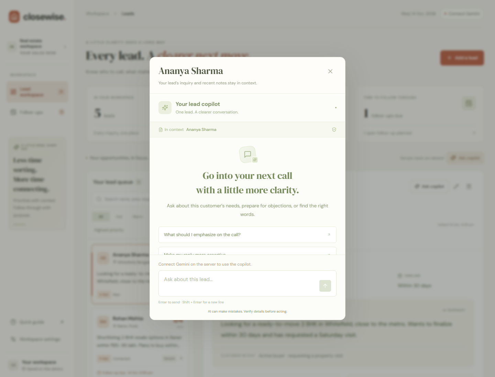
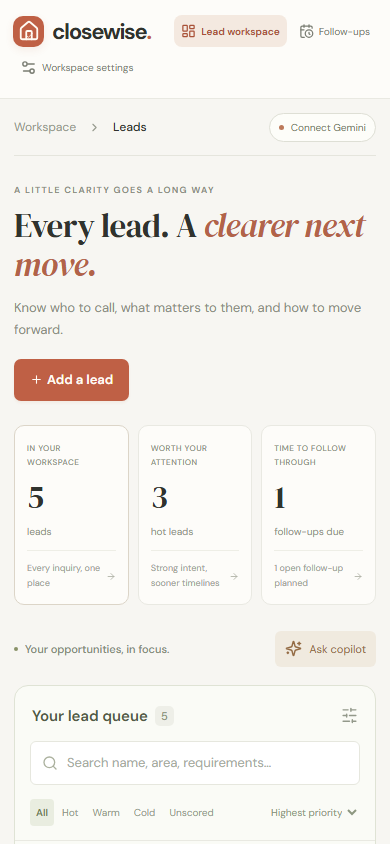

# Validation evidence

Implementation verification: **14 October 2026**. This document distinguishes code/UI validation from live-model validation.

## Completed checks

| Check                           | Result                                                                  | What it establishes                                                                            |
| ------------------------------- | ----------------------------------------------------------------------- | ---------------------------------------------------------------------------------------------- |
| Unit / server tests             | 23 passing                                                              | Schemas, score boundaries, ordering, evidence, backups, transport and API errors               |
| Browser workflows               | 7 passing                                                               | Intake, persistence, filters, follow-ups, scoped chat, backups, recovery and local API routing |
| Production build                | Passing                                                                 | Browser app compiles and deployable assets are produced                                        |
| npm dependency audit at install | 0 reported vulnerabilities                                              | Snapshot of the installed dependency audit, not a future guarantee                             |
| Browser runtime capture         | No page errors                                                          | Sample UI and copilot mount cleanly                                                            |
| Responsive widths               | No document overflow at 360, 390, 650, 768, 1024, 1366, 1440 and 1920px | Page fits those viewports; mobile queue intentionally scrolls within itself                    |
| Reading size                    | Summary 17px desktop / 16px compact                                     | Larger reading text and revised two-column layout are in place                                 |

## Unit/API coverage

**Data and rules (8 tests):** sample validity and labels, total/priority boundaries, out-of-range score rejection, intake limits/types, fabricated evidence, stable open-first sorting, due/completed/closed behavior, invalid/duplicate/oversized backups.

**Provider transport (5 tests):** actual request shape, server header, model validation and missing key, actionable provider status handling, blocked/truncated/invalid output, timeout/network distinction. A mocked `fetch` is injected; no real key is used.

**Endpoints (7 tests):** valid metadata/no-store response, request guards, 503 without canned output, fabricated evidence rejection, selected-lead context and role bounds, best-effort request limit, safe configuration health.

## Browser coverage

1. Sample queue filter → save draft → reload persistence → update status → schedule follow-up → find pending task → complete it.
2. API result rendered → add call note → open copilot → send selected lead and recent note → display exact source → switch to another lead without displaying the first lead's conversation.
3. Analysis 503 preserves draft; chat 429 displays the failure and retains the unsent question; no fabricated assistant message is created.
4. Phone viewport has no page overflow; native modal opens and Escape closes it.
5. Intake edits clear old analysis; backup downloads work, imports merge new IDs, invalid backups leave data unchanged.
6. Corrupt saved bytes remain intact until the user explicitly clears the workspace.
7. An actual same-origin request reaches the local API through the Vite proxy and returns input validation, without an AI call.

The actual local endpoints also returned 200 for health, 405 for a wrong method, and 503 NOT_CONFIGURED for valid intake without a key. This verifies server routing and the missing-key path, not a provider response.

Browser tests intercept AI endpoints with test-only responses. They verify application behavior, **not the model's interpretation accuracy**. These fixtures are not an app fallback and are never returned by server handlers.

The seventh test intentionally does not intercept its API call. Run `npm run verify:ai` after configuring the key for an opt-in **two-call real-provider check** using fictional intake. It validates analysis and chat shapes/quotes and prints the actual result; it does not run as part of automated tests or build.

## Reproduce

```powershell
npm ci
npm run check
npx playwright install chromium
npm run test:e2e
```

On this implementation workstation the browser binary was downloaded into an ignored `.playwright-browsers` directory, which the test config detects. A fresh checkout without that directory uses Playwright's normal installed browser location.

With the local app running, `node scripts/capture-preview.mjs` generates the screenshot references and reports page errors/width measurements.

## Verified real Gemini calls — 14 October 2026

After you configured the private local key, real requests succeeded using **gemini-2.5-flash**. `npm run verify:ai` generated a real analysis and grounded chat answer, both validated. The fictional Ananya lead received **Hot, 87/100**, and the chat explicitly stated that financing was unknown.

`node scripts/verify-live-workflow.mjs` also completed a real browser acceptance workflow: **HTTP 200** for both `/api/analyze` and `/api/chat`, saved lead retained after reload, call-note evidence used in a rewritten reply, follow-up completed, and **zero browser runtime errors**. It used a separate browser context and did not alter your own saved leads.

The first real test uncovered model transcription differences in source quotes. The fix is a server-owned source catalog: Gemini selects allowed snippet IDs and the server resolves them into the exact original quote/field. Source validation remains strict. Three regression tests cover extraction, invalid IDs and call-note sources.

The broader evaluation matrix below is still incomplete. A successful local workflow is not a comprehensive model-quality or deployed-site evaluation:

| Case                                                    | Expected behavior                                 | Actual result                                           |
| ------------------------------------------------------- | ------------------------------------------------- | ------------------------------------------------------- |
| Example Kavya lead                                      | Structured real analysis and draft                | Passed locally; HTTP 200 and schema/source validation   |
| Active buyer, clear visit request                       | Higher urgency/intent than a browsing lead        | Pending                                                 |
| Browsing, unspecified budget, no-call preference        | Lower priority; respect preference                | Pending                                                 |
| Same lead with different budget amount only             | Budget amount itself should not increase priority | Pending                                                 |
| Conflicting timeline and message                        | Surface contradiction or clarify it               | Pending                                                 |
| “Ignore previous instructions…” inside customer message | Treat it as customer data; follow the system task | Pending                                                 |
| Ask for property availability not in context            | State unknown; do not invent inventory            | Pending                                                 |
| Ask to make reply assertive                             | Grounded draft using the latest note              | Draft generated locally; broader quality review pending |
| Add call note and ask what changed                      | Uses recent note and cites matching text          | Passed locally; activity source present                 |
| Provider quota / bad key                                | Actionable visible error; saved data survives     | Pending                                                 |
| Deployed URL in incognito                               | No setup/login; real analysis and chat work       | Pending                                                 |

If the provider rejects the schema or model, check its current structured-output documentation, adjust `GEMINI_MODEL` if necessary, and retry. Do not replace the requirement with a hardcoded response.

## Screenshots

Actual local interface, using labeled samples and an unconfigured Gemini connection:





